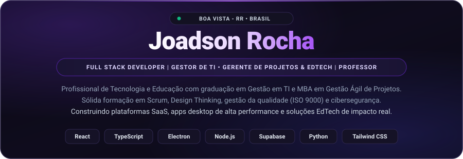
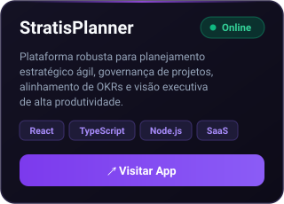
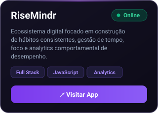
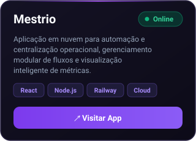

  

    

  
  
  

 

<h2 align="center">🚀 Produtos em Produção (SaaS)</h2>

Soluções em nuvem desenhadas para produtividade, estratégia e automação operacional

  
  
  

 

<h2 align="center">💻 Portfólio Open Source</h2>

Destaques em Desktop, Full Stack, Mídia e EdTech

| Projeto | Categoria | Descrição | Acesso |
|---------|-----------|-----------|--------|
| **EbookFinder** | `Desktop & AI` | Organizador offline de e-books e quadrinhos (EPUB, PDF, CBZ) com IA (SkillBook) | [Ver Repo ↗](https://github.com/JoadsonRocha/EbookFinder) |
| **MultDownload 4.0** | `Electron` | Downloader de vídeos e áudios do YouTube (até 8K) com interface moderna | [Ver Repo ↗](https://github.com/JoadsonRocha/MultDownload_Oficial) |
| **Lumina Presentation** | `Desktop` | Apresentador profissional com projeção dual-screen e exportação PPTX/PDF | [Ver Repo ↗](https://github.com/JoadsonRocha/lumina-presentation) |
| **MediaFinder** | `Desktop` | Organizador e player de vídeos locais com busca inteligente e capas | [Ver Repo ↗](https://github.com/JoadsonRocha/MediaFinder) |

<b>📂 Explorar todos os repositórios por categoria (17 projetos)</b>

#### 🖥️ Desktop & Electron
- **[EbookFinder](https://github.com/JoadsonRocha/EbookFinder)** — Organizador offline de e-books e quadrinhos (EPUB, PDF, CBZ) com IA (SkillBook)
- **[MultDownload 4.0](https://github.com/JoadsonRocha/MultDownload_Oficial)** — Downloader de vídeos e áudios do YouTube (até 8K) com interface moderna
- **[Lumina Presentation](https://github.com/JoadsonRocha/lumina-presentation)** — Apresentador profissional com projeção dual-screen e exportação PPTX/PDF
- **[MediaFinder](https://github.com/JoadsonRocha/MediaFinder)** — Organizador e player de vídeos locais com busca inteligente
- **[YouFinder](https://github.com/JoadsonRocha/YouFinder)** — Reprodutor minimalista de vídeos do YouTube com controle de tela

#### 📱 Mobile & Cross-Platform
- **[EbookFinder (Android)](https://github.com/JoadsonRocha/EbookFinder)** — Versão mobile com Capacitor
- **[MultDownloader Kivy](https://github.com/JoadsonRocha/MultDownloader---Kivy-Android)** — Versão Android do MultDownloader

#### 🌐 Web & Full Stack
- **[KoFoco](https://github.com/JoadsonRocha/KoFoco)** — App de produtividade inspirado na palavra tupi “agora”
- **[FlowHub](https://github.com/JoadsonRocha/FlowHub)** — Gerenciador de tarefas diárias
- **[My Daily Habits](https://github.com/JoadsonRocha/My-Daily-Habits)** — Acompanhamento de hábitos e rotinas
- **[AGROFACIL](https://github.com/JoadsonRocha/AGROFACIL)** — Sistema inteligente para agricultura e piscicultura familiar
- **[NEXUS](https://github.com/JoadsonRocha/NEXUS_OFICIAL)** — Plataforma de gestão eleitoral e CRM político
- **[NextBlog CMS](https://github.com/JoadsonRocha/NextBlog---CMS)** — CMS moderno com editor de blocos e IA

#### 🎧 Mídia & Utilidades
- **[PodCast-Studio](https://github.com/JoadsonRocha/PodCast-Studio)** — Converte documentos e textos em podcasts com vozes de IA
- **[localpdf.io GUI](https://github.com/JoadsonRocha/localpdf.io)** — Interface gráfica para manipulação de PDFs offline
- **[MultDownloader](https://github.com/JoadsonRocha/MultDownloader)** — Versão Python/Tkinter do downloader

#### 📚 Educação & Outros
- **[EduInclusivo](https://github.com/JoadsonRocha/EduInclusivo)** — Assistente de planos de aula e PEI com IA
- **[HIASD / HIASD-py](https://github.com/JoadsonRocha/HIASD-py)** — Hinário Adventista (versões JS e Python)

 

<h2 align="center">🛠️ Stack Tecnológica</h2>

  

  
  
  
  
  
  

 

<h2 align="center">📊 GitHub Analytics</h2>

  
  

 

  
⭐️ <em>Se gostou de algum projeto, considere deixar uma estrela!</em>

  
<strong>"Código limpo, impacto real."</strong> • <a href="https://joadsonrocha.github.io/">joadsonrocha.github.io</a>

